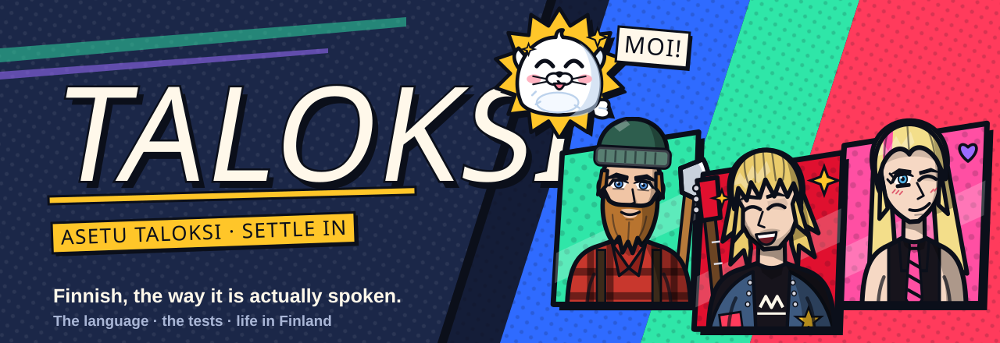
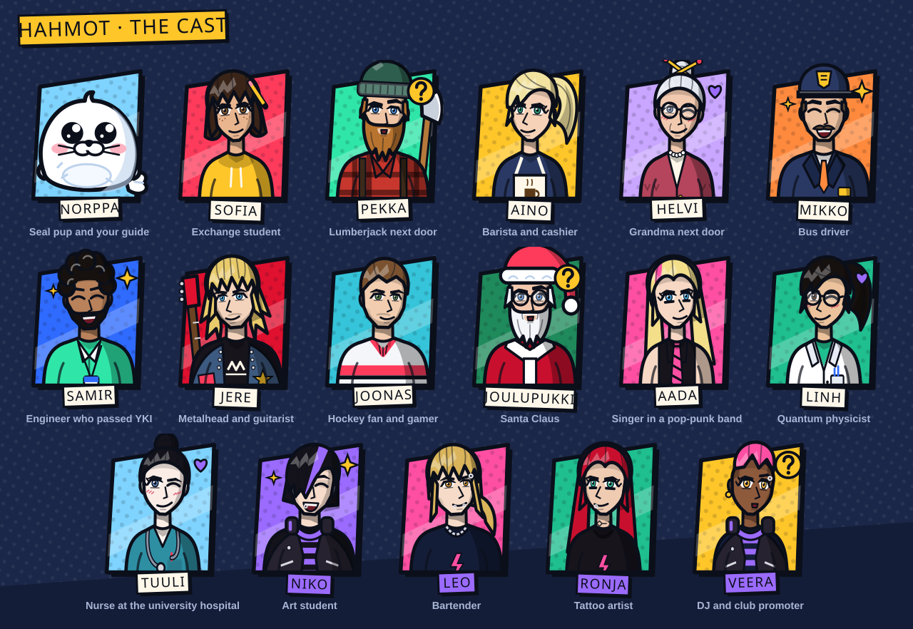

<div align="center">



<br>

**Learn Finnish. Pass the tests. Make yourself at home.**

A free app for people building a life in Finland: a full Finnish course with the spoken language built in,<br>
and practice for the exams that come with staying.

<br>


[**Roadmap**](docs/ROADMAP.md) &nbsp;·&nbsp; [Quick start](#quick-start) &nbsp;·&nbsp; [The cast](#the-cast) &nbsp;·&nbsp; [Progress](#progress)

</div>

<br>

## The name

*Asettua taloksi* is the Finnish for settling in: making yourself at home somewhere new. That is the whole job of the app, in one word.

> **Asetu taloksi.** Settle in.

It is also a small Finnish lesson. *Talo* is a house; the ending *-ksi* means *becoming* or *as*. Endings like that are how Finnish works, and the app teaches them one at a time.

<sub>The project started under the working title <b>Suomeksi</b> ("in Finnish").</sub>

<br>

## Three things in one app

<table>
<tr>
<td width="33%" valign="top">

### 🗣️ The language

A structured course from zero toward B1. Textbook Finnish and the Finnish people actually say, side by side on every sentence.

**Today:** a starter unit and 4 units, 26 lessons, 18 exercise types, spaced-repetition review.

</td>
<td width="33%" valign="top">

### 🎓 The tests

Practice for Finland's citizenship test, which applies to applications from 1 March 2027, and later for the YKI language exam.

**Today:** planned. It is the next thing being built after the starter unit.

</td>
<td width="33%" valign="top">

### 🏠 Life here

How things work: sauna etiquette, shoes off, Kela, the bus. Facts about Finland sit inside the lessons themselves.

**Today:** 12 culture notes, 7 practical notes. Scenario lessons are planned.

</td>
</tr>
</table>

<br>

## The cast

Seventeen characters, each with their own voice, their own way of talking, and the topics they teach. One of them hosts every lesson and reacts to your answers.

<div align="center">

</div>

<br>

| | Who | Teaches |
|---|---|---|
| **Norppa** | A Saimaa seal pup who somehow knows all fifteen cases | The basics |
| **Pekka** | Lumberjack. Built like a spruce, talks about as much as one | Home, forest, sauna |
| **Aino** | Barista running on four coffees and no patience | Shops, prices, fast spoken Finnish |
| **Helvi** | Eighty-one, bakes every Friday, firm opinions on shoes in the hallway | Food, family, manners |
| **Mikko** | Has driven bus line 6 for nineteen years and been late twice | Numbers, directions, transport |
| **Samir** | Came for a job, passed the language exam, now helps the next newcomers | Paperwork, work, exams |
| **Jere** | Metalhead. Gentle, polite, extremely loud | Music, drinks, feelings |

…plus Sofia, Joonas, Joulupukki, Aada, Linh and Tuuli, and four more behind the 18+ setting.

Every portrait is drawn in code, not from image files: six expressions each, a signature prop, and a name tag in their own style. The pictures on this page are rendered from the same components the app uses (`npm run readme-art`).

<br>

## Built for Finnish, not adapted to it

Generic language apps teach Finnish the way they teach Spanish. The hard parts of Finnish are different, so the tools are too.

| | |
|---|---|
| **Puhekieli on every sentence** | *Minä olen* is what the textbook says. *Mä oon* is what you will hear. Both are shown, both have audio. |
| **Sentence breakdowns** | Any sentence taken apart into stems and endings, with the reason for each. |
| **One new idea at a time** | A word appears in its plain form first. A new ending is never used before the lesson that explains it. |
| **Case gym and verb gym** | Any noun in any of ten cases; verbs in textbook or spoken Finnish. |
| **Exercises for Finnish problems** | Ending detective, pick the right form, street Finnish, long-or-short listening. |
| **Tap any word** | A quick translation for every word in a Finnish sentence. |
| **Review that adapts** | Flashcards scheduled with FSRS, the algorithm behind modern Anki. |
| **An 18+ track** | Behind a setting: the bar, swearing, dating. The Finnish adults use and textbooks leave out. |

<br>

## The look: Kaamos Ink

*Kaamos* is the polar night. The app is comic-ink panels on a dark winter sky.

- Paper-coloured panels with thick ink outlines and hard offset shadows, never blurred ones
- Slanted condensed type, labels as tilted bars, halftone dots
- Flat saturated colours named after Finnish things: lake blue, aurora green, lingonberry red, cloudberry gold, bilberry purple
- Characters with realistic proportions and hard cel shadows

       

<br>

## Progress

**v0.2, playable on web.** Sprint 4 of 12.

```
Sprints done            █████░░░░░░░░░░░░░░░   3 / 12
Course to B1 (units)    ███░░░░░░░░░░░░░░░░░   5 / 33
A1 units                █████████░░░░░░░░░░░   5 / 11
Units with review pass  ██████████████░░░░░░   5 / 7
Characters with lessons ████████████░░░░░░░░  10 / 17
Skill rooms with grading░░░░░░░░░░░░░░░░░░░░   0 / 4
Citizenship pack parts  ░░░░░░░░░░░░░░░░░░░░   0 / 5
```

| Platform | State |
|---|---|
| Web | ✅ Runs and has been clicked through |
| Android | ⬜ Not tested yet |
| iOS | ⬜ Not tested yet |

> **About the content.** All course content is written by AI and checked by AI: units 0–4 have had a review pass, the two 18+ units not yet. No native speaker has read it. The app says so too. If you speak Finnish natively, [your corrections](#contributing) are the most valuable contribution there is.

### Goalposts

| | Goalpost | Reached when | |
|---|---|---|---|
| 1 | **Playable prototype** | A full lesson can be played start to finish on web | ✅ |
| 2 | **Its own identity** | Own visual style, a cast, a voice for every line | ✅ |
| 3 | **A proper beginning** | A starter unit for letters, sounds and sentence structure; no lesson uses grammar before explaining it | ✅ |
| 4 | **Citizenship test practice** | Study guide, practice by topic and a mock test, every item with a source, usable on a phone. Target: before 1 March 2027 | ⏳ |
| 5 | **A1 complete** | Units 0–10, each with a checkpoint test and a story | ⬜ |
| 6 | **Progress that follows you** | An account keeps progress across devices | ⬜ |
| 7 | **Four real skills** | Listening, reading, writing and speaking each have graded tasks | ⬜ |
| 8 | **Public beta** | In a store, open to anyone | ⬜ |
| 9 | **A2, then B1** | The course reaches YKI level 3 | ⬜ |

<details>
<summary><b>Sprint plan</b></summary>

<br>

Run as a solo Scrum project, rotating through four roles each sprint: Scrum Lead, Content Quality, Documentation, Tech Lead. Every sprint ends with a review in [`docs/sprints/`](docs/sprints/).

| # | Sprint | Goal | |
|---|---|---|---|
| 1 | **Foundations** | App, learning engine, FSRS, 4 A1 units | ✅ [Review](docs/sprints/sprint-01-foundations.md) |
| 2 | **Voice and identity** | Audio for every item, the cast, own visual style, breakdowns, journey map, 18+ pack | ✅ [Review](docs/sprints/sprint-02-voice-and-identity.md) |
| 3 | **Starter and structure** | Unit 0, concept cards, no grammar before its explanation, review pass on units 1–4 | ✅ [Review](docs/sprints/sprint-03-starter-and-structure.md) |
| 4 | **Exam-prep engine** | Question-bank format, practice by topic, mock test, source tracking | ⏳ |
| 5 | **Citizenship content** | Study guide, question bank and term pack built from the official learning material | ⬜ |
| 6 | **Citizenship launch** | Info page, phone testing, hosting, installable web app, icon | ⬜ |
| 7 | **A1 complete** | Word-frequency data, units 5–10, checkpoints, placement check, a story per unit | ⬜ |
| 8 | **Accounts and sync** | Sign-in and progress sync | ⬜ |
| 9 | **Learning science** | Mistake bank, typed review, gradation and partitive drills | ⬜ |
| 10 | **Skill rooms** | Graded listening, reading, writing and speaking | ⬜ |
| 11 | **Life in Finland and YKI** | Scenario lessons, YKI practice, more 18+ units | ⬜ |
| 12 | **Mobile release and public beta** | Store release, reminders, usage numbers | ⬜ |

</details>

The [roadmap](docs/ROADMAP.md) has the detail: who the app is for, a diagram of how its parts connect, a register of every feature with what it depends on, the citizenship test plan, and the decisions still open.

<br>

## Quick start

```bash
git clone https://github.com/FrankPonce/taloksi.git
cd taloksi
npm install
npx expo install --fix     # aligns native package versions with your Expo SDK
npm run web                # or: npm run android / npm run ios (Expo Go)
```

Before committing:

```bash
npm run validate           # ids, hosts, speakers, fill-ins, stories, audio coverage
npm run typecheck
```

<details>
<summary><b>Regenerating audio and README art</b></summary>

<br>

Audio clips for the current content are already in `assets/audio/`. After changing content:

```bash
pip install edge-tts
npm run audio              # writes assets/audio/* and src/audio/manifest.ts
```

`edge-tts` is free but unofficial; see the note at the top of `scripts/generate_audio.py`. For an open, offline alternative with a single voice, run `python scripts/generate_audio.py --engine piper`.

The banner and cast sheet on this page are rendered from the app's character components:

```bash
npm run readme-art         # writes docs/assets/banner.svg and cast.svg
```

</details>

<details>
<summary><b>Project structure</b></summary>

<br>

```
app/                     expo-router screens
  (tabs)/                Learn path · Review · Practice · Guide · Profile
  lesson/[id].tsx        lesson player (queue, hearts, feedback, re-queue)
  grammar/ story/ write/ grammar notes, stories, writing tasks
  gym/                   case gym, verb gym
  journey.tsx  cast.tsx  journey map, the characters
src/
  content/               course data as JSON (units, lexicon, characters, stories,
                         dialogues, curriculum, guide, culture) + typed loaders
  engine/                exercise generator, answer checker, FSRS, achievements
  components/            UI kit, character art, sentence breakdown, one component per exercise
  state/store.ts         progress, saved on the device
  audio/                 clip manifest + device text-to-speech fallback
  theme.ts               design tokens
scripts/                 audio generation, content validation, README art, open-data importers
docs/                    roadmap, sprint reviews, content guide, README artwork
```

Content is plain JSON on purpose: a reviewer can fix a sentence in a pull request without touching code, and the Python scripts can read it directly.

</details>

**Built with** Expo and React Native · TypeScript · expo-router · zustand · ts-fsrs · react-native-svg

<br>

## Contributing

If you speak Finnish natively, reading the course is the most useful thing you can do: nobody has yet. Content is plain JSON in `src/content/`, so a correction is a one-line pull request; the checklist is in [docs/CONTENT.md](docs/CONTENT.md). Run `npm run validate` and `npm run typecheck` before opening one.

## Licence and credits

No licence has been chosen yet, so for now all rights are reserved. This is an open decision in the roadmap.

Data sources are credited in [ATTRIBUTION.md](ATTRIBUTION.md). Open data (Wiktionary via kaikki.org, Tatoeba) only enters the course through the review pipeline in `scripts/`.

<br>

<div align="center">

Built in Turku by [Frank Ponce](https://frankponce.dev)

<sub>Not affiliated with Duolingo, LingoDeer, Migri or any exam authority. Exam practice in this app is unofficial.</sub>

</div>
