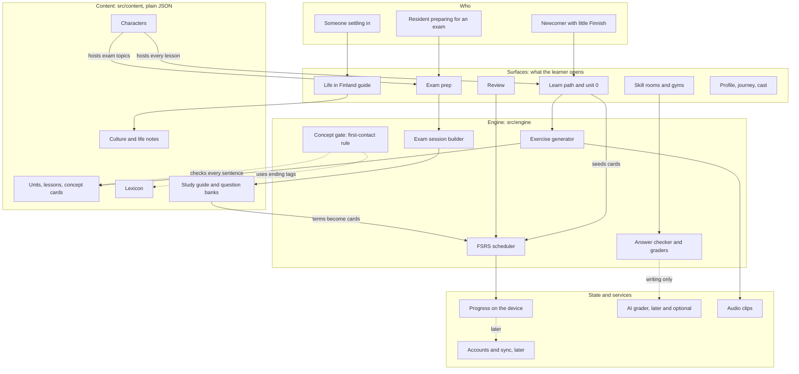

# Taloksi roadmap

What the app is meant to be, how its parts connect, what exists today, and the order things get built in. Sections 4 and 5 are the tracking tables: update them when something ships. Last revised 2026-11-11.

Legend: ✅ shipped · 🟡 partly there · 🗓️ planned (sprint number) · 🔬 needs a decision · 🅿️ parked until there is data · ❌ decided against

## 1. Direction and scope

Taloksi (first called Suomeksi) is a complete Finnish course, plus the two things newcomers hit once they live here: understanding how daily life works, and the exams that come with staying (YKI, and from 2027 the citizenship test). It is one app with one engine and several tracks.

### Who it is for

| Who | What they need | Track | State |
|---|---|---|---|
| Newcomer with little or no Finnish | A path from zero, spoken Finnish, phrases for daily life | **Course** (A1 to B1) | ✅ units 1–4, more planned |
| Resident preparing for the citizenship test or YKI | The test topics in the Finnish they will face, practice, a mock test | **Exam prep** | 🗓️ sprints 4–6 |
| Someone who has just arrived | How DVV, Kela, banks, doctors and rent work, and the words for them | **Life in Finland** | 🟡 notes shipped, scenarios planned |
| Adult learners who want the real thing | Slang, swearing, bars, dating | **18+** (setting, off by default) | 🟡 2 units |
| Organisations (municipalities, employers) | Licences for staff or clients | not a track | 🔬 see section 10 |

### The scope test

A feature gets in only if it does at least one of these:

1. teaches Finnish;
2. prepares a learner for a concrete requirement they face (YKI, the citizenship test, a form, a visit to the doctor);
3. keeps people coming back to 1 or 2.

Everything else is out. Applying it: a directory of integration services is out (VINCE does that, see below, and the app links to it); importing your own media is out; leagues are only in if data shows they bring people back (3).

## 2. Principles

1. **Complete, not cluttered.** Everything needed to reach B1 and pass YKI is in the app, and nothing that fails the scope test.
2. **Useful words first.** New vocabulary is ordered by how often it is used in real Finnish, after a short on-ramp of survival basics.
3. **Recall beats recognition.** A lesson starts with tapping and ends with typing, spelling and building from nothing.
4. **Spoken Finnish is not an extra.** Puhekieli is on every sentence from lesson one.
5. **Finland is part of the course.** Sentences carry facts about the country, units carry culture notes, and a track covers practical life.
6. **One new idea at a time.** A word is met in its plain form first. A new ending is never used before it has been introduced, and the first time it appears the lesson stops to explain it.
7. **Characters carry the course.** One character hosts each lesson, units mix hosts, and each character owns topics.
8. **Official facts come from official sources.** Anything about law, exams or services cites its source and the date it was checked. The app gives practice and explanation, not legal advice, and says it is not official.
9. **Works without a server.** Everything that teaches runs on the device. Accounts, sync and AI grading are additions that fail gracefully.
10. **Zero budget.** Free tiers, open data, open-source tools.

## 3. Where it stands

### Against other Finnish learning apps

| | Duolingo | Speakly | WordDive | LingQ | Taloksi now | Taloksi finished |
|---|---|---|---|---|---|---|
| Core method | Gamified translation drills | High-frequency phrases | Typed active recall | Reading and listening input | Generated lessons, 18 exercise types, FSRS review | Same, with frequency-ordered vocabulary and more typing |
| Spoken Finnish (puhekieli) | Very little | In dialogues | Separate courses | Whatever you import | ✅ On every sentence | ✅ Plus puhekieli-only stories |
| Grammar help | Sparse tips | Reference guide | Inside examples | None | ✅ Notes per unit, sentence breakdowns, case and verb gyms | ✅ Plus a searchable grammar reference |
| The four skills | Mixed into lessons | Listening and speaking situations | Spelling and speaking | Reading and listening | 🟡 Hub exists; writing and speaking are self-checked | ✅ A room per skill, each with graded tasks |
| Content shape | Fixed path | Fixed levels | Topic packs | Bring your own | ✅ Fixed path plus an 18+ track | ✅ Path to B1, 18+, life in Finland, exam prep |

What is taken from each: Speakly's frequency ordering and situation dialogues, WordDive's insistence on typing, and from LingQ only the tap-any-word gloss, which is already in.

### Next to VINCE

VINCE (Virtual Integration Home) is a different product. It is an app led by Turku University of Applied Sciences with the City of Turku and Sateenkaari Koto, and Swedish partners, that uses AI to answer newcomers' questions about housing, studies, benefits and similar things. It does not teach Finnish. According to its [project page](https://www.turkuamk.fi/en/project/virtual-integration-home-promoting-inclusion-and-empowerment-digitally-vince/) it is distributed through partner organisations, not as a public download; the page is undated, so that may have changed. Its [launch press release](https://centralbaltic.eu/project-news/application-launch-press-release-22-1-26/) is from January 2026.

The split: VINCE answers "where do I go and what are the rules?", Taloksi answers "what does this letter say, how do I say it, and am I ready for the test?". So Taloksi does not copy a services directory. Where a lesson or note touches a service, it links to the official page, and to VINCE if it becomes public.

## 4. How it fits together

### The picture



### The layers

| Layer | Lives in | Holds | Today | Next |
|---|---|---|---|---|
| Content | `src/content/*.json` | Units, lessons, lexicon, characters, stories, dialogues, writing prompts, culture and life notes, gym data | ✅ | Concept cards (sprint 3), question banks and study guide (sprints 4–5) |
| Engine | `src/engine/` | Exercise generator, answer checker, FSRS, achievements | ✅ | Concept gate (3), exam session builder (4), mistake bank (9) |
| Surfaces | `app/` | Learn path, Review, Practice hub, Guide, Profile, Cast, Journey | ✅ | Unit 0 (3), Exam prep (4), onboarding (7) |
| State | `src/state/store.ts` | Progress, settings, FSRS cards, saved on the device | ✅ | Sync (8) |
| Services | outside the app | Nothing yet | none | Accounts (8), AI grader (10, if decided) |

The rule for services: each one is optional. If sign-in, sync or the AI grader is down, lessons, review and exam practice still work.

### Tracks

A track is a content area. They share the lesson engine, review, audio and the cast, and differ in what unlocks them.

| Track | Content type | Unlock | Where it lives |
|---|---|---|---|
| Course | units with lessons (`track: main`) | in order | `units/unit*.json` |
| 18+ | units (`track: adult`) | setting in Profile | `units/unitx*.json` |
| Life in Finland | scenario lessons (`track: life`, new) | after unit 2 | `units/unitl*.json` |
| Exam prep | topics, study pages, question banks (new content type) | always open | `exam/*.json` |

### New content shapes

Two content types are new in the plan. Both are shown as sketches; the fields may change when they are built.

**Concept card** (sprint 3). A short explanation that opens the first lesson to use an ending. It is what the validator checks sentences against.

```json
{
  "id": "k_ssa",
  "title": "Turussa: being in a place",
  "tag": "ine",
  "introducedIn": "u2l1",
  "examples": [["Turku", "Turussa"], ["Helsinki", "Helsingissä"], ["Suomi", "Suomessa"]],
  "rule": "…",
  "practice": 2
}
```

The lexicon already tags each word form with its ending (`ine`, `ela`, `ill`, `ade`, `all`, `par`, …). The validator rule: a sentence in lesson L may only use a form whose tag has a card with `introducedIn` at or before L, and the base word must have appeared in an earlier lesson.

**Exam question** (sprint 4). One multiple-choice item with its source attached, so no question exists without one.

```json
{
  "id": "q_rights_017",
  "topic": "fundamental-rights",
  "q": { "fi": "…", "en": "…" },
  "options": ["…", "…", "…", "…"],
  "answer": 1,
  "why": { "fi": "…", "en": "…" },
  "source": { "label": "…", "url": "…", "checked": "2027-01-10" },
  "terms": ["perustuslaki", "yhdenvertaisuus"],
  "status": "draft"
}
```

`terms` link into the lexicon, so words from the exam become Review cards. `status` is `draft` until checked against the official learning material. The English text is shown in study mode and hidden in mock-test mode.

### How the pieces feed each other

- Finishing a lesson seeds FSRS cards for its words and sentences; Review schedules them.
- Missing an exam question adds its `terms` to Review, so exam prep and the course strengthen each other.
- The mistake bank (sprint 9) pulls wrong answers from every surface into the warm-up of the next lesson.
- Hosts follow topics: Samir presents society and paperwork, Tuuli health, Mikko transport. The same characters appear in lessons, exam topics and life scenarios, so the app feels like one place.
- Concept cards double as the future grammar reference, one page per ending.

## 5. Feature register

One row per feature. **Needs** lists the IDs that must exist first; "ext" means something outside the project.

### Course (C)

| ID | Feature | State | Needs | Sprint |
|---|---|---|---|---|
| C1 | Learn path, locked progression, hearts, XP, streaks | ✅ | | |
| C2 | Exercise engine, 18 exercise types | ✅ | | |
| C3 | Lesson hosts that react to answers | ✅ | | |
| C4 | Unit 0: letters, sounds, sentence structure | 🗓️ | C2 | 3 |
| C5 | Concept cards and the strict first-contact rule (content, card screen, validator) | 🗓️ | lexicon tags ✅ | 3 |
| C6 | Units 1–4 rewritten to obey C5, plus review pass | 🗓️ | C5 | 3 |
| C7 | Frequency-ordered vocabulary from open data | 🟡 scripts exist | | 3 |
| C8 | Shorter lessons: 15 to 20 steps, from about 32 | 🗓️ | | 7 |
| C9 | Units 5–10, A1 complete, with the seven hosts who have no lessons | 🗓️ | C5 | 7 |
| C10 | Unit checkpoints | 🗓️ | C9 | 7 |
| C11 | A story per unit | 🗓️ | C9 | 7 |
| C12 | Puhekieli shown from the start, tested from A1.3 | 🗓️ | | 7 |
| C13 | Placement check and "why are you learning" question | 🗓️ | | 7 |
| C14 | A2 and B1 units | 🗓️ | C9 | after 12 |

### Skills (S)

| ID | Feature | State | Needs | Sprint |
|---|---|---|---|---|
| S1 | Listening room: stories with hidden text, long-or-short drill | 🟡 | | 10 |
| S2 | Reading room: graded texts with questions | 🟡 | | 10 |
| S3 | Writing room: prompts with a keyword checker, then AI grading | 🟡 | decision 1 | 10 |
| S4 | Speaking room: shadowing, then speech recognition | 🟡 | | 10 |
| S5 | Case gym, verb gym, sentence breakdowns, tap-any-word | ✅ | | |
| S6 | Gradation and partitive drills | 🗓️ | C5 | 9 |
| S7 | Compound-word splitter | 🗓️ | | 9 |
| S8 | Word families | 🗓️ | | 9 |

### Memory (M)

| ID | Feature | State | Needs | Sprint |
|---|---|---|---|---|
| M1 | FSRS review with Again / Hard / Good / Easy | ✅ | | |
| M2 | Mistake bank feeding lesson warm-ups | 🗓️ | M1 | 9 |
| M3 | Typed review for mature cards | 🗓️ | M1 | 9 |
| M4 | FSRS parameters fitted to the learner's own history | 🗓️ | M1, enough data | 9 |
| M5 | Exam terms feed Review | 🗓️ | M1, X5 | 5 |

### Exam prep (X)

| ID | Feature | State | Needs | Sprint |
|---|---|---|---|---|
| X1 | Study guide in simple Finnish with an English glossary, one chapter per official topic | 🗓️ | official material (ext) | 5 |
| X2 | Question-bank format and validator that rejects items without a source | 🗓️ | | 4 |
| X3 | Practice by topic, with an explanation after each answer | 🗓️ | X2 | 4 |
| X4 | Mock test with a score per topic | 🗓️ | X2 | 4 |
| X5 | Term pack: the words the exam uses, as Review cards | 🗓️ | X2, official material (ext) | 5 |
| X6 | Source tracker, "draft" flag, "not official" notice, report-a-problem link | 🗓️ | X2 | 4 |
| X7 | Eligibility and info page: who must take it, exemptions, alternatives, links to Migri | 🗓️ | official pages (ext) | 6 |
| X8 | YKI practice in the exam's own formats | 🗓️ | S1–S4 | 11 |

### Life in Finland (L)

| ID | Feature | State | Needs | Sprint |
|---|---|---|---|---|
| L1 | Culture notes (12) | ✅ | | |
| L2 | Practical notes on living here (7) | ✅ | | |
| L3 | Scenario lessons: DVV, Kela, bank, doctor, renting, job interview | 🗓️ | C2 | 11 |
| L4 | Real letters annotated line by line (Kela, tax, Migri) | 🗓️ | | 11 |
| L5 | Offline survival phrasebook, 30 phrases | 🗓️ | | 7 |
| L6 | Links out to official services | 🗓️ | | 11 |

### Cast and look (V)

| ID | Feature | State | Needs | Sprint |
|---|---|---|---|---|
| V1 | Cast of 17 with builds, poses, six expressions, props, voices | ✅ | | |
| V2 | Backdrop per unit, Kaamos Ink style | ✅ | | |
| V3 | 18+ track | 🟡 2 units | | 11 |
| V4 | App icon and splash screen | 🗓️ | | 6 |
| V5 | Full-body character art | 🔬 | decision 3 | |
| V6 | Astrid, a Finland-Swedish character: portrait, voice, bio, then lessons on bilingual Finland | 🗓️ | V1; lessons need C9 | 7 or later |

### Platform (P)

| ID | Feature | State | Needs | Sprint |
|---|---|---|---|---|
| P1 | Web app, state saved on the device, works offline | ✅ | | |
| P2 | Phone testing on Android and iOS | 🗓️ | | 6 |
| P3 | Hosting and an installable web app | 🗓️ | | 6 |
| P4 | Accounts and sync | 🗓️ | | 8 |
| P5 | AI service for writing grading and "explain my mistake" | 🔬 | decision 1, P4 | 10 |
| P6 | Reminders | 🗓️ | P3 | 12 |
| P7 | Store release | 🗓️ | P2, V4 | 12 |
| P8 | Privacy-respecting usage numbers | 🗓️ | P3 | 12 |
| P9 | Explanations in more languages than English | 🔬 | decision 8 | |

### Money (B)

| ID | Feature | State | Needs | Sprint |
|---|---|---|---|---|
| B1 | Free core course | ✅ | | |
| B2 | Paid exam pack | 🔬 | P4, decision 7 | |
| B3 | Organisation licences | 🔬 | P4, decision 7 | |
| B4 | Leagues, friends, streak freeze | 🅿️ | P4 | |

### The citizenship pack: what "minimum" means

The pack is ready to launch when all five exist: **X1** study guide, **X2** question bank, **X3** practice by topic, **X4** mock test, **X5** term pack. X6 (sources and notices) and X7 (info page) are required alongside, because the pack touches a legal process.

## 6. The parts in detail

### The main path

| Stage | CEFR | Units | Status |
|---|---|---|---|
| Starter | pre-A1 | 0: letters and sounds, how a Finnish sentence works | 🗓️ 3 |
| Survival basics | A1.1 | 1–4: greetings, origins, shop and café, the city | ✅ 16 lessons, no review pass yet; to be re-ordered to follow the first-contact rule |
| Everyday life | A1.2–A1.3 | 5–10: time, family, home, weather, health, work | 🗓️ 7 |
| Getting by | A2 | 11–20 | 🗓️ after launch |
| Independent | B1 (YKI 3) | 21–32 | 🗓️ after launch |

A1 and A2 are the launch target for the course. B1 is where it is meant to end up.

### The four skill rooms

| Room | Today | Finished |
|---|---|---|
| **Listening** | Stories with the text hidden, long-or-short sound drill | A clip, then questions about what was said. Normal and slow speed. Puhekieli clips from A2. |
| **Reading** | Stories with tap-to-translate | Graded texts per stage: signs, messages, short news, forms. Questions after each. |
| **Writing** | 3 prompts, scored by a keyword checker that does not understand Finnish | Prompts per stage ("introduce yourself: age, where you are from, your job, a hobby, your favourite colour") graded by an AI with a mark out of 5 and corrections line by line. |
| **Speaking** | Shadowing, self-graded | Say-the-sentence with speech recognition, then role-play with a character. |

All four also appear inside ordinary lessons, so the rooms are extra practice, not the only place a skill is trained.

### The cast

One host per lesson, mixed within a unit. Hosts react to your answers. "Wanted for" says which topic the character is meant to own once the units exist.

| Character | Who | Their topics | Lessons today |
|---|---|---|---|
| Norppa | Seal pup, the mascot | The basics, grammar explanations, nature | 1 |
| Sofia | Exchange student | Introductions, languages, university | 2 |
| Pekka | Lumberjack | Home, forest, sauna, going places | 2 |
| Aino | Barista | Shops, cafés, prices, spoken Finnish | 2 |
| Helvi | Grandma | Food, family, manners, small talk | 2 |
| Mikko | Bus driver | Numbers, directions, transport, time | 3 |
| Samir | Engineer who passed YKI | Newcomer survival, paperwork, work, exams; presents exam prep | 3 |
| Jere | Metalhead | Drinks, music, festivals, feelings | 2 |
| Joonas | Hockey fan | Hobbies, sports, free time | 0, wanted for unit 6 or 7 |
| Joulupukki | Santa Claus | Winter, Christmas, Lapland, months and seasons | 0, wanted for the weather unit |
| Aada | Pop-punk singer | Opinions, likes and dislikes, clothes, shopping | 0, wanted for a clothes and opinions unit |
| Linh | Quantum physicist | Studying, science, technology, big numbers | 0, wanted for the work and study units |
| Tuuli | Nurse | Health, the body, the doctor, emergencies | 0, wanted for the health unit |
| Astrid (planned) | Finland-Swede (*finlandssvensk*), blonde | Bilingual Finland: Turku / Åbo, two-language signs, the coast and archipelago, Swedish loanwords in Finnish | not drawn yet; see V6 |
| Niko (18+) | Art student | Swearing, feelings, arguments | 2 |
| Leo (18+) | Bartender | Bars, flirting, dating | 2 |
| Ronja (18+) | Tattoo artist | Bodies, slang, insults | 0 |
| Veera (18+) | DJ | Clubs, nights out, the morning after | 0 |

### The 18+ track

Behind a setting, off by default. It is a parallel track with its own units. Today: 2 units, 5 lessons. Planned units: nights out (Veera), bodies and health without the euphemisms (Ronja), relationships and breakups (Leo), arguing and insults (Niko, Ronja), sex and consent, work and money complaints.

### Life in Finland

Shipped: 7 practical notes and 12 culture notes. Planned (sprint 11): scenario lessons hosted by Samir and Tuuli, annotated real letters, and links to official services. Scenarios teach the words and the steps ("what does this letter ask me to do?"); they do not replace the official source for the rules.

### The look

Kaamos Ink: comic-ink panels, hard shadows, slanted type. Characters are drawn in code with realistic proportions, sharp eyes, hard cel shadows, two body builds, varied head angles, six expressions and a signature prop each. Each unit has a backdrop that matches its topic. Full-body art for unit headers is undecided (decision 3).

## 7. How the language is introduced

This is the part of the plan that changes the course itself, not the app around it.

### Unit 0: the starter

Four short lessons before unit 1, hosted by Norppa. There is no vocabulary to memorise; the goal is that nothing in unit 1 looks or sounds strange.

| Lesson | Teaches | How |
|---|---|---|
| 0.1 Aakkoset | The alphabet. Finnish is spelled the way it sounds: one letter, one sound, always. The letters that matter: ä, ö, y, and j said like English y. | Hear a letter, tap it. Hear a word, pick the spelling. |
| 0.2 Pitkä ja lyhyt | Long and short sounds change the meaning: *tuli* (fire), *tuuli* (wind), *tulli* (customs). Stress is always on the first syllable. | The long-or-short listening drill that already exists, moved here and extended. |
| 0.3 Ä vai A | Vowel harmony: a word uses a, o, u or ä, ö, y, not both, and endings follow (*talossa*, *metsässä*). | Sort words into two groups; pick the ending that matches. |
| 0.4 Miten lause toimii | How a sentence is built: no articles, no grammatical gender (*hän* is he and she), no future tense, the verb ending says who is doing it (*olen*, *olet*, *on*), and small words like "in" and "from" are endings glued to the noun. | Build three-word sentences from tiles; a preview of endings with no testing. |

A learner who already knows this can skip it with a five-question check.

### The first-contact rule

Decided: the rule is strict. A form may not appear in the lesson that introduces its word, and the unit 1 and 2 sentences that break it get rewritten in sprint 3. The only exception is fixed phrases, as described in point 3.

1. **Plain form first.** A noun appears in its dictionary form (*Turku*, *kahvi*, *bussi*) for at least one lesson before any other form of it is used.
2. **A concept card on first contact.** The first lesson that uses a new ending opens with a short card: what it means, two or three words shown side by side in both forms (*Turku → Turussa*, *Helsinki → Helsingissä*, *Suomi → Suomessa*), and when to use it. Then two easy exercises on only that, before it shows up in sentences.
3. **Nothing early.** A sentence may only use endings whose concept card the learner has already seen. Useful phrases that break this ("Mitä kuuluu?", "Puhutko englantia?") are allowed as fixed phrases: taught whole, marked as a phrase, and not taken apart until their grammar arrives.
4. **Later forms point back.** When *Turun* appears in unit 4, its card shows the forms already known next to it: *Turku · Turussa · Turusta · Turun*.

The validator enforces rule 3 (see "New content shapes" in section 4).

### Where the current course breaks the rule

The four existing units were written before this rule. Known cases to fix when unit 0 is added:

- Unit 1 lesson 3 uses *ystäviä* and *opiskelijoita* (partitive plural) in "Me olemme ystäviä" and "He ovat opiskelijoita" with no explanation.
- Unit 1 lesson 4 uses *englantia* (partitive) in "Puhutko englantia?". This one can stay as a fixed phrase.
- Unit 2 lesson 1 uses *Espanjasta* and *Suomessa* in the same lesson that first teaches the words *Espanja* and *Suomi*.

This list comes from reading the lessons, not from a full audit; the validator check will find the rest.

### The order concepts arrive in (A1)

| # | Concept | Example | First used |
|---|---|---|---|
| 1 | Verb *olla* and the persons | minä olen, sinä olet | Unit 1 |
| 2 | Questions with *-ko / -kö* | Oletko sinä…? | Unit 1 |
| 3 | Negation with *ei* | en ole, en puhu | Unit 1 |
| 4 | "In": *-ssa / -ssä* | Turussa | Unit 2 |
| 5 | "From": *-sta / -stä* | Espanjasta | Unit 2 |
| 6 | Verb type 1 | puhun, asun | Unit 2 |
| 7 | Partitive after numbers and for "some" | kaksi kahvia, leipää | Unit 3 |
| 8 | "On / at / with": *-lla / -llä*; having | minulla on, bussilla | Units 3–4 |
| 9 | "Into": the illative | kauppaan, Helsinkiin | Unit 4 |
| 10 | Possession: *-n* | Turun, kirjaston vieressä | Unit 4 |
| 11 | Consonant gradation, named and explained | pankki → pankissa | Unit 4, after it has been seen a few times |
| 12 | Verb types 2–5, past tense, object forms | | Units 5–10 |

## 8. The citizenship test pack

### What is known

Checked on 2026-11-11 against [Migri's announcement](https://migri.fi/en/-/finland-to-introduce-citizenship-test-as-changes-to-citizenship-act-take-effect-on-1-january-2027), its [Finnish page on the change](https://migri.fi/kansalaisuuslain-muutos-2027), and the [government's page](https://valtioneuvosto.fi/en/-/1410869/citizenship-test-to-assess-knowledge-of-finnish-society-and-its-key-principles).

| Fact | Detail |
|---|---|
| Law in force | 1 January 2027 |
| Test applies to | applications submitted on or after 1 March 2027; earlier ones are handled under the current Act |
| Who | applicants aged 18 to 64; exemptions possible for health, disability or other very serious reasons |
| Language | Finnish or Swedish. Not English. |
| Topics | key legislation, fundamental and human rights, equality including gender equality, Finnish history and culture |
| Format | multiple choice, taken on a computer at a test site |
| Pass mark | "most answers must be correct", no number given |
| Alternatives | a Finnish- or Swedish-language matriculation exam, or a higher-education degree completed in Finnish or Swedish in Finland |
| Learning material | to be published on Migri's website around the turn of 2026–27; the University of Helsinki is preparing material and questions |
| First tests | around March 2027 |

### What is not known

Number of questions, exact pass mark, fee, test sites and dates, how to register, whether the learning material will exist in English or other languages, and the terms for reusing it. Third-party sites with "official" practice questions turned up in searches; none could be verified, and some say themselves that their questions are not official. They are not used as sources.

### What it means for the product

- **The test is in Finnish.** Someone preparing for it needs Finnish at roughly the level of the test's questions, so this pack is for learners past A2, not for beginners. It is a different audience from the A1 course, which is why it does not depend on unit 0.
- **The language is half the job.** The pack explains each topic in simple Finnish with an English glossary and drills the vocabulary the questions use. That is where it connects to the rest of the app: the term pack feeds Review.
- **The stakes are high.** Content drafted by AI and read by no native speaker is not good enough on its own for something people rely on for a legal process. Every item cites its source, carries a `draft` flag until it is checked against the official learning material, and the app says it is unofficial. See open decision 9.

### Getting hold of sample tests

As of 2026-11-11 no official sample test or learning material has been published; Migri says more information would follow in autumn 2026 and the material around the turn of the year. So the plan is in stages:

1. **Now (sprint 4):** build the engine and the screens, and fill them with a small set of items written from primary public sources for the four official topic areas (the Constitution and fundamental rights, equality and non-discrimination law, Finnish history and culture from public information pages). These are test data and are marked `draft`.
2. **Watch Migri.** Check its citizenship pages weekly until the learning material appears. This can be automated with a scheduled check.
3. **When the material is out (sprint 5):** read it, map the study guide and question bank to its chapters, and write new questions for each. Official questions and text are never copied; the app links to them instead.
4. **If sample questions are published:** use them to match the style, length and difficulty of questions, and link to them from the app.

### Scope

Minimum to launch: X1 to X5, with X6 and X7 (section 5). Target: live before 1 March 2027. Later: YKI practice (X8), a Swedish-language version of the study guide, and printable summaries.

## 9. Sprint plan

About two weeks each, part-time, one at a time. Roles rotate: Scrum Lead, Content Quality, Documentation, Tech Lead. Dates are targets from 2026-11-11; the real dependency for sprints 5 and 6 is Migri publishing its learning material.

There is no native-speaker review sprint: nobody is available to do one. Every content sprint ends with a review pass by Claude against the checklist in `docs/CONTENT.md`. It catches grammar slips, unnatural phrasing, wrong translations and rule breaks, but it is not the same as a native speaker reading the course, and the app says so. If a native speaker turns up later, their corrections go in as ordinary pull requests.

| # | Sprint | Delivers | Done when | Target |
|---|---|---|---|---|
| 1 | Foundations ✅ | App, exercise engine, FSRS, 4 units, gyms, stories | Runs on web, validator passes | |
| 2 | Voice and identity ✅ | Audio for every item, cast, visual style, breakdowns, journey map, 18+ pack | Every item has a clip | |
| 3 | Starter and structure ⏳ | C4–C7: unit 0, concept cards and the validator rule, units 1–4 rewritten and reviewed, word-frequency data | Validator passes with the rule on | 25 Nov |
| 4 | Exam-prep engine | X2, X3, X4, X6: question-bank format and validator, practice, mock test, source tracker, notices; a small draft bank as test data | A mock test runs end to end on web; the validator rejects an item without a source | 9 Dec |
| 5 | Citizenship content | X1, X5, M5 from the official material: study guide, question bank v1, term pack feeding Review. Fallback if the material is late: the four published topics, labelled draft | Every chapter of the official material has a study page and about 8 to 10 questions, all with sources; review pass done | 6 Jan |
| 6 | Citizenship launch | X7, P2, P3, V4: info page, phone testing, hosting, installable web app, icon | Someone can open a link on a phone, install it and run a mock test offline | 3 Feb |
| 7 | A1 complete | C8–C13: units 5–10, shorter lessons, checkpoints, placement, phrasebook (L5), a story per unit | About 600 words, each unit through a review pass | |
| 8 | Accounts and sync | P4 | Progress survives a reinstall | |
| 9 | Learning science | M2–M4, S6–S8 | Retention measured against defaults | |
| 10 | Skill rooms | S1–S4, P5 if decided | Each room has 10 graded tasks | |
| 11 | Life in Finland and YKI | L3, L4, L6, X8, more 18+ units | 10 scenario lessons | |
| 12 | Mobile release and public beta | P6–P8, store release, a decision on money | Installable from a store; first-month numbers | |

### What blocks what

| Blocked | By |
|---|---|
| X1, X5, final X2 content | Migri publishing its learning material (external) |
| C6, then C9 | C5, the concept cards and the validator rule |
| M5 | X5 and M1 |
| P5, B2, B3 | P4, accounts |
| S3 as finished | decision 1, the AI grader |
| P7 | P2 phone testing and V4 icon |

Sprint 3 is deliberately short and stays first: the concept-card system it adds is also what the exam study pages will use for their explanations. Sprints 4 to 6 go before the rest of A1 because the citizenship test has a date and the course does not.

## 10. Money

Not decided, and not needed before sprint 12. What has been suggested, and what each needs:

| Option | What it is | Needs | Concern |
|---|---|---|---|
| Free core, paid exam pack | Course free; a citizenship (later YKI) pack for a one-time price or a small monthly one | P4 accounts, a way to take payment, a business registration and VAT handling | Selling exam content that nobody native has checked is a problem; the pack would need a human check against the official material before it costs money. Prices that have been floated (about €15–25 once, or a few euros a month) are guesses and untested. |
| Licences for organisations | Municipalities and employers buy access for clients or staff | P4, a teacher or admin view (backlog), privacy and accessibility work | Long sales cycles. Public bodies buy content they can vouch for, which again means reviewed content. VINCE is handed out through partner organisations that agree costs with its owner, which suggests the same route here. The claim that this is worth far more than individual subscriptions is untested. |
| Grants | Funding for a free tool | A free core course helps | Needs a legal entity and a track record |

Whatever is chosen has to fit the zero-budget constraint (store fees, hosting, payment fees) and the licence: the repository currently has no licence, which keeps every commercial option open.

Recommendation: keep everything free through the citizenship launch (sprint 6), collect real usage and feedback, and decide with data. If the exam pack is ever sold, check it with a human first.

## 11. Open decisions

1. **AI writing grader.** It needs a model and somewhere to keep the key. Options: a small server function on a free tier that calls a hosted model, with a daily cap per user; or wait for accounts (sprint 8) and attach it to them. Until then the keyword checker stays and is labelled as such.
2. **Voices.** The clips come from an unofficial free service whose terms for redistribution are unclear. Before a public release: confirm the terms, switch to the open single-voice engine, or record people. This now matters before sprint 6, not sprint 12, because the citizenship pack goes public first.
3. **Character art.** Stay with code-drawn portraits, or commission or draw full illustrations and keep the code version as a fallback.
4. **Licence.** The repository is public but has no licence file yet, so nobody can legally reuse it. Code and course content may want different licences, and the money decision (10) shapes the choice.
5. **How far the course goes.** B1 is the stated end. Whether B2 and beyond are lessons or only a reading and listening library is undecided.
6. **Name.** Taloksi is chosen and the app is renamed; the repository rename and the availability checks are still to do. See below.
7. **Money.** Section 10. Default: free until sprint 12.
8. **Explanation languages.** All explanations are English. Newcomers speak many other languages (VINCE offers Finnish, English, Swedish and Ukrainian), so this limits reach. Machine-translated explanations cannot be checked by anyone here. Default: English only until the course has a review route for other languages.
9. **Who checks the exam content.** With no native reviewer, accuracy rests on citing a source for every item, a `draft` flag, a visible "not official" notice and a report-a-problem link. Whether to find a human checker before launch is open.

### On the name

The brand is **Taloksi**, from the idiom *asettua taloksi*: to settle in, to make yourself at home. Tagline: "Asetu taloksi. Settle in." It covers all three sides of the app (the language, the tests, life here), it is a real Finnish expression, and explaining it makes a first lesson: *talo* is a house, *-ksi* means becoming.

An earlier version of this section argued against the name on the grounds that *taloksi* alone reads as "into a house". That missed the idiom, which is the point of the name. *Kotoisa* ("homely", echoing *koto* in *kotoutuminen*, integration) was the other shortlisted option.

What is done and what is not:

- ✅ README and its artwork use Taloksi.
- ✅ The app's title, `app.json`, `package.json`, the app identifiers and the in-app text are renamed. The saved-progress key keeps the old name so nobody loses progress.
- ⬜ The GitHub repository is still `suomeksi`. Renaming it changes its URL (GitHub redirects the old one) and is done in the repository's settings.
- ⬜ App stores, domains and trademarks have not been checked for "Taloksi". Do that before the first store listing in sprint 12; a rename after that is expensive.

## 12. Backlog

Ideas that have been raised and do not yet pass the scope test, or have no sprint.

- AI "explain my mistake"
- Searchable grammar reference, built from the concept cards
- Swedish-speaker track for Turku / Åbo, and a Swedish version of the citizenship study guide. Astrid (V6) would host both.
- Custom flashcard decks
- Teacher or organisation view
- Photo of a letter to tap-to-translate (OCR). People who tested VINCE reportedly asked for scanning and translation help. It overlaps with L4, annotated real letters, which is cheaper and checkable.
- Leagues, friends and streak freeze (B4), parked until data shows they bring people back
